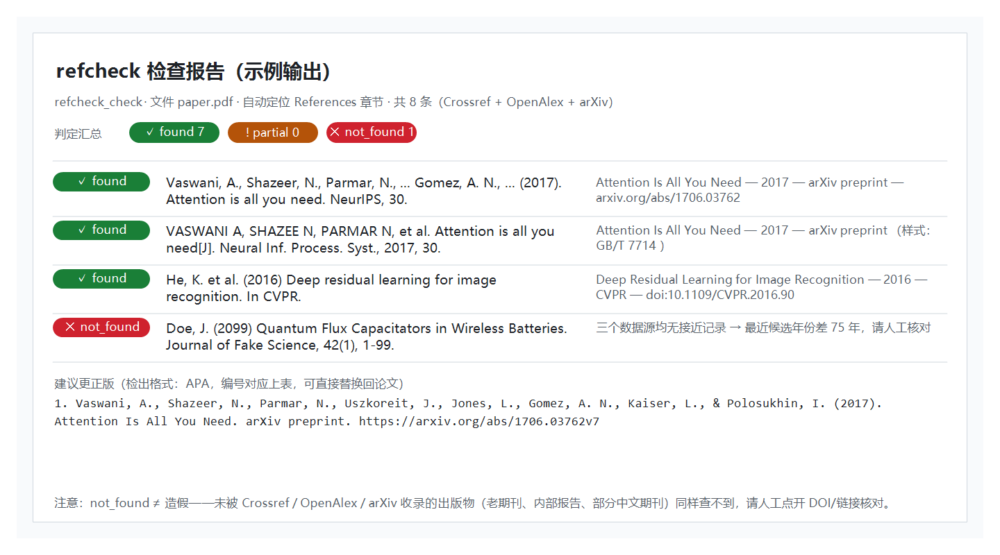

[中文](README.md)

# dsh-reference-checker (Reference Verification · 参考文献真实性检查器)

[](https://github.com/Yu-tao-Li/dsh-reference-checker/actions/workflows/ci.yml)
[](LICENSE)
[](https://github.com/Yu-tao-Li/dsh-reference-checker/releases)

[](https://github.com/Yu-tao-Li/dsh-reference-checker)

[](https://awesome-dsh-plugin.com)

**Reference-verification for [DeepSeek Harness](https://github.com/deepseek-ai/deepseek-harness)** — one model tool, `reference_checker`, that takes a paper (`.pdf` / `.bib` / `.tex` / `.txt` / `.md`) or a pasted reference list and verifies every entry against **Crossref / OpenAlex / arXiv**. Each reference gets a verdict (`found` / `partial` / `not_found` / `error`), the closest real record (title, year, venue, volume, pages, DOI/URL), and a **corrected citation in the input's own style** (APA, GB/T 7714, IEEE, Vancouver, MLA, Chicago, Harvard, ACS, or BibTeX) — ready to paste back into the paper.

Host-only plugin (no browser UI, no services); the single runtime dependency is `pdf-parse` (PDF text-layer extraction).

| ① Sample report: mixed-style input, per-entry verdicts + corrected citations (actual output style) |
|---|
|  |

## Features

- **Three index sources, queried concurrently** — Crossref (bibliographic) + OpenAlex (open scholarly) + arXiv (preprints; queried only for English titles); 4-way concurrency, 15 s timeout per request, one automatic retry on 429/5xx, and per-source status (`ok` / `error` / candidate count) reported honestly for every reference.
- **Strict verdicts, honest reporting** — `found` requires strong two-sided title overlap, year within ±1, and a first-author match (when the candidate carries author metadata); `partial` = a plausible real record exists but details differ (⚠ verify by hand); `not_found` = no close record in any of the three indexes (**≠ fabricated** — old journals, internal reports, theses, and many Chinese journals simply aren't indexed there); `error` = every source failed (with the reason).
- **8 citation styles + BibTeX, auto-detected** — per-line heuristics: GB/T 7714 via its `[J]`/`[M]`/`[D]` document-type markers, IEEE via `[n]` numbering + quoted title, APA via `Last, F. (Year). Title`, Harvard via single-quoted titles, Vancouver/ACS via their author-block shapes; the **corrected citation is emitted in that entry's detected style** (full author list, volume/issue/pages, DOI), numbered to match, drop-in replaceable.
- **Whole paper files** — `.pdf` gets its text layer extracted and the **References section located automatically** (heading scan from the end of the document); `.bib` parsed by brace depth; `.tex` takes the `thebibliography` block or the `.bib` files named by `\bibliography{...}`; other text is read as UTF-8 with an automatic GBK fallback for Chinese Windows files.
- **Bounded** — checks the first 50 references by default (hard cap 200); truncation is flagged in the result.

## Install

npm package: [dsh-reference-checker](https://www.npmjs.com/package/dsh-reference-checker).
Prebuilt packages: [GitHub Releases](https://github.com/Yu-tao-Li/dsh-reference-checker/releases).

```sh
# from GitHub (--profile selects the target profile)
dsh plugin --profile web add github:Yu-tao-Li/dsh-reference-checker
```

Restart `dsh web` (or the dsh process); `reference_checker` is then available in every session.

> The bundle resolves by package name (`cordis.patch.yml` is a single mount line), so it installs into any profile / `$DSH_HOME` — no hardcoded paths.

## Usage

Just tell the agent "check whether the references in `paper.pdf` are real" and hand it the file — or paste a reference list. Tool parameters:

| Parameter | Description |
|---|---|
| `path` | File path: `.pdf` / `.bib` / `.tex` / `.txt` / `.md` / other text; relative paths resolve against the session workspace |
| `references` | Pasted text: one citation per line (any common style), or a full BibTeX document |
| `maxRefs` | Upper bound (default 50, hard cap 200) |

Verdict legend:

| Status | Meaning |
|---|---|
| ✅ `found` | A real record with a near-identical title exists (±1 year, author matches), with full bibliographic details |
| ⚠️ `partial` | A plausible real record exists but details differ (moderate title overlap) — verify by hand |
| ❌ `not_found` | No close record in any of the three sources — **not a fabrication verdict** (unindexed publications also miss) |
| ⛔ `error` | All source lookups failed for this entry (with the reason) |

Every `found`/`partial` entry carries `best` (the closest real record: title / year / venue / volume / pages / DOI or URL) and `corrected` (the normalized citation in the input's style).

## How it works

```
reference_checker (model tool, in the DSH host process)
   │
   ├─ extract   .pdf → pdf-parse text layer + References-section location
   │            .bib → brace-depth parser   .tex → thebibliography / \bibliography
   │            text → References/Bibliography section, else line-by-line
   │
   ├─ per reference (concurrency 4):
   │    ├─ Crossref  bibliographic query
   │    ├─ OpenAlex  open-scholarly search
   │    └─ arXiv     preprint API (English titles only)
   │
   ├─ score     0.72 × title-token overlap + 0.18 × year + 0.10 × first author
   │            found = total ≥ 0.80 AND title overlap ≥ 0.75
   │                    AND year gap < 3 AND no definite author mismatch
   │
   └─ emit      verdict + closest real record + corrected citation in the input style
                (structured JSON + human-readable report)
```

Design details (title-guessing heuristics, scoring math, pitfalls) are in [docs/dev-notes.md](docs/dev-notes.md).

## Safety & limitations

- **`not_found` ≠ fabricated** — publications not indexed by Crossref/OpenAlex/arXiv (old journals, internal reports, theses, many Chinese journals) are equally unfindable. The report always attaches the closest real record (with DOI/URL); open it and verify before concluding anything.
- **Scanned PDFs** (no extractable text layer) are refused explicitly — provide a text-based PDF or paste the references instead.
- **Public-API etiquette** — the tool queries three public bibliographic services; 50 references per call by default. Use it in moderation, not in loops.
- **Read-only** — the plugin only reads the file you hand it; it writes nothing. Network access is limited to the three index APIs.
- Node ≥ 22, cross-platform, no native dependencies.

## Development

```
lib/host.mjs                   the whole plugin: extraction + verification + styles (single-file ESM)
test-smoke.mjs                 offline: minimal PDF generation → text extraction → 4 source parses
test-regression.mjs            offline: tool schema, Vancouver parsing/titles, mocked lookups
test-e2e.mjs                   online: 9 mixed-style references against the real APIs + assertions
scripts/make-screenshot.ps1    regenerate the README sample screenshot (Windows PowerShell + GDI+)
docs/dev-notes.md              design rationale, scoring math, pitfalls, version history
```

```sh
npm install          # fetch pdf-parse
npm test            # offline regressions + PDF smoke test
node test-e2e.mjs    # online (needs internet access to the three indexes)
```

CI (`.github/workflows/ci.yml`) runs offline regressions and PDF smoke tests on Linux / Windows with Node 22 / 24 for every push/PR; the online e2e is local-only (it depends on the public bibliographic APIs).

## 1.1.1 fixes

- Register tool parameters as an object JSON Schema, fixing model requests rejected with HTTP 400.
- Split pasted Vancouver citations with comma-separated years and volumes, while retaining wrapped author lists.
- Strip Vancouver author blocks before title queries and preserve periods inside abbreviations such as `et al.`, `e.g.`, `Jr.`, and `Fig.`.

See [issue #1](https://github.com/Yu-tao-Li/dsh-reference-checker/issues/1).

## License

MIT — see [LICENSE](LICENSE). The single runtime dependency `pdf-parse` (MIT) is documented in [THIRD_PARTY.md](THIRD_PARTY.md).
