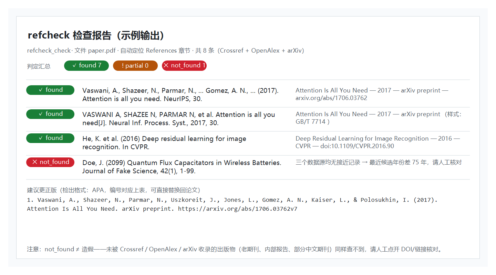

[English](README.en.md)

# dsh-refcheck

[](https://github.com/Yu-tao-Li/dsh-refcheck/actions/workflows/ci.yml)
[](LICENSE)

[](https://github.com/Yu-tao-Li/dsh-refcheck)

**给 [DeepSeek Harness](https://github.com/deepseek-ai/deepseek-harness) 装上参考文献真实性检查能力**——一个模型工具 `refcheck_check`，把一篇论文（`.pdf` / `.bib` / `.tex` / `.txt` / `.md`）或一段粘贴的文献列表逐条对照 **Crossref / OpenAlex / arXiv** 三个公开书目索引核对，逐条判定 `found` / `partial` / `not_found` / `error`，并**按输入样式**（APA、GB/T 7714、IEEE、Vancouver、MLA、Chicago、Harvard、ACS + BibTeX）生成可直接替换回论文的**更正版引用**。

纯宿主端插件（host-only，无浏览器 UI、不碰你的文件除读取外）；唯一运行时依赖 `pdf-parse`（提取 PDF 文本层）。

| ① 示例报告：混合格式输入逐条判定 + 更正版引用（真实运行输出样式） |
|---|
|  |

## 特性

- **三大数据源并发核对**——Crossref（DOI/书目）+ OpenAlex（开放学术）+ arXiv（预印本，仅对英文标题查询）；4 并发、每请求 15s 超时、429/5xx 自动重试一次，单条引用的各数据源状态（`ok`/`error`/候选数）全部如实上报。
- **严格判定，诚实上报**——`found` 必须同时满足：标题双向强重合、年份差 ≤1、（候选带作者信息时）第一作者匹配；`partial` = 存在可信的真实记录但细节有出入（⚠ 人工核对）；`not_found` = 三个库里都查不到接近记录（**≠ 造假**——老期刊、内部报告、部分中文期刊同样未被收录）；`error` = 全部数据源失败（附原因）。
- **8 种引用样式 + BibTeX 自动识别**——逐行启发式识别：GB/T 7714 看 `[J]`/`[M]`/`[D]` 文献类型标记，IEEE 看 `[n]` 编号 + 引号题名，APA 看 `Last, F. (Year). Title`，Harvard 看单引号题名，Vancouver/ACS 看作者块形态；**更正版引用按该条输入样式生成**（全作者、卷期页、DOI），编号对应，直接替换。
- **直接查论文文件**——`.pdf` 提取文本层并**自动定位 References 章节**（从文档末尾向前扫描标题）；`.bib` 按括号深度解析条目；`.tex` 取 `thebibliography` 块或 `\bibliography{...}` 指向的 `.bib`；其他文本按 UTF-8 读取（GBK 自动回退，兼容中文 Windows 文件）。
- **规模可控**——默认检查前 50 条（硬上限 200），超限截断并在结果中明确标记 `truncated`。

## 安装

```sh
# 从 GitHub（--profile 指定装进哪个 profile）
dsh plugin --profile web add github:Yu-tao-Li/dsh-refcheck
```

重启 `dsh web`（或重启 dsh 进程），`refcheck_check` 在所有会话可用。

> bundle 按包名自解析（`cordis.patch.yml` 只有一行挂载），任何 profile / `$DSH_HOME` 都能装，无硬编码路径。

## 用法

直接对 agent 说"检查这份论文的参考文献是否真实"并把文件给它，或把文献列表粘过去。工具参数：

| 参数 | 说明 |
|---|---|
| `path` | 文件路径：`.pdf` / `.bib` / `.tex` / `.txt` / `.md` / 其他文本；相对路径相对会话工作区解析 |
| `references` | 粘贴文本：一行一条引用（任意常见样式），或整段 BibTeX |
| `maxRefs` | 检查上限（默认 50，硬上限 200） |

判定图例：

| 状态 | 含义 |
|---|---|
| ✅ `found` | 存在标题近乎一致的真实记录（±1 年，作者匹配），附完整书目信息 |
| ⚠️ `partial` | 存在可信真实记录但细节有出入（标题重合度中等），需人工核对 |
| ❌ `not_found` | 三个数据源均无接近记录——**不等于造假**（未收录的出版物同样查不到） |
| ⛔ `error` | 该条的全部数据源查询失败（附错误原因） |

每条 `found`/`partial` 附 `best`（最接近的真实记录：标题/年份/出处/卷期页/DOI 或链接）与 `corrected`（按输入样式的更正版引用）。

## 工作原理

```
refcheck_check（模型工具，宿主进程内）
   │
   ├─ 提取  .pdf → pdf-parse 文本层 + References 章节定位
   │        .bib → 括号深度解析   .tex → thebibliography / \bibliography
   │        文本 → References/Bibliography/参考文献 章节，否则整段按行
   │
   ├─ 每条引用（并发 4）：
   │    ├─ Crossref  书目查询
   │    ├─ OpenAlex  开放学术搜索
   │    └─ arXiv     预印本 API（英文标题时）
   │
   ├─ 打分  0.72 × 标题 token 重合 + 0.18 × 年份 + 0.10 × 第一作者
   │        found 阈值：总分 ≥ 0.80 且标题重合 ≥ 0.75 且年份差 < 3 且作者未明确不匹配
   │
   └─ 输出  状态 + 最近真实记录 + 按输入样式的更正版引用（JSON + 人类可读报告）
```

设计细节（标题抽取启发式、打分公式、踩坑记录）见 [docs/dev-notes.md](docs/dev-notes.md)。

## 安全与限制

- **`not_found` ≠ 造假**——未被 Crossref/OpenAlex/arXiv 收录的出版物（老期刊、内部报告、学位论文、部分中文期刊）同样查不到。报告对每条都附最接近的真实记录（含 DOI/链接），请人工点开核对后再下结论。
- **扫描件 PDF**（无可提取文本层）会被明确拒绝，提示提供文本版 PDF 或直接粘贴参考文献。
- **公共 API 礼仪**——查询三个公开书目服务，默认单次 50 条；请节制批量使用，不要循环反复跑。
- **只读**——插件只读取你给的文件，不写任何文件；网络访问仅限上述三个数据源的 API。
- Node ≥ 22，跨平台，无原生依赖。

## 开发

```
lib/host.mjs                    全部本体：提取 + 核对 + 判定 + 样式模板（单文件 ESM）
test-smoke.mjs                  离线：最小 PDF 生成 → 文本提取 → 四种来源解析
test-e2e.mjs                    在线：8 行混合格式真实核对 + 样式/更正版回归断言
scripts/make-screenshot.ps1     重生成 README 示例截图（Windows PowerShell + GDI+）
docs/dev-notes.md               设计原理、打分公式、踩坑记录、版本历史
```

```sh
npm install          # 拉 pdf-parse
node test-smoke.mjs  # 离线
node test-e2e.mjs    # 在线（需要能访问三个数据源）
```

CI（`.github/workflows/ci.yml`）在每次 push/PR 时于 `ubuntu-latest` 跑离线 smoke 测试；在线 e2e 仅本地运行（依赖公网书目 API）。

## 许可

MIT，见 [LICENSE](LICENSE)。唯一运行时依赖 `pdf-parse`（MIT）的来源与版本声明见 [THIRD_PARTY.md](THIRD_PARTY.md)。
